# Petri

Petri is a pet project of mine for experimenting with genetic programming in an
artificial-life simulation. Creatures with evolvable brains forage, breed,
steal from each other and die on a seeded world, and every child inherits a
mutated copy of its parent's genome: its brain, its learning rules and its
color.

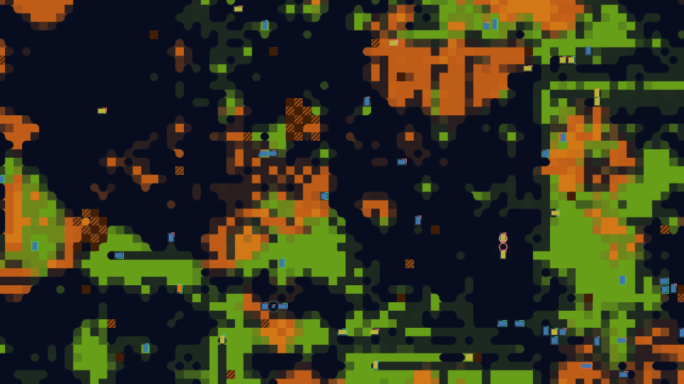

<sub>Confluence world, run seed 33, around tick 13,000: about 4,400 creatures
whose mean generation is about 190. A creature's color is set by six heritable
genes that drift under mutation, so color marks lineage. Green is grass, orange
is fruit, hatched brown is barrier rock.</sub>

It is based on a program I had fun with in college, where genetic-programming
creatures scavenged, reproduced, communicated and evolved in a shared
ecosystem. Petri is written in Rust, and it is one of the main projects I use
to try new agentic coding workflows and tools: features are built with Claude
and Codex agents through a written [roadmap workflow](docs/workflow.md).

The goal is a world that feels alive: many ways of making a living lasting side
by side, and lineages that evolve behavior which depends on remembering,
learning and predicting, not only reacting.

## What is in the repository

| Part | Where | What it does |
| --- | --- | --- |
| Simulation | [`crates/v3-core`](crates/v3-core) | Deterministic world, creatures, mesh brains, mutation and learning |
| Server | [`crates/v3-server`](crates/v3-server) | HTTP and WebSocket API that streams the running world |
| Web UI | [`frontend/`](frontend) | React viewer: world map, inspectors and live statistics |
| CLI | [`crates/v3-cli`](crates/v3-cli) | Headless runs, world inspection and seeded benchmarks |
| Telemetry | [`telemetry/`](telemetry) | OpenTelemetry export into a local Grafana stack, with report pages |
| Lab | [`crates/v3-lab`](crates/v3-lab) | Small fixed arenas that test whether a capability can evolve |

## Quick start

Install [Aqua](https://aquaproj.github.io/) 2.60.1 or newer and Rust 1.99.1
through rustup, then run:

```sh
make setup
make run
```

Open <http://localhost:5173>. `make setup` creates project-local Aqua links for
the pinned Node 24.20.0 (with npm 11.19.0), uv 0.12.1 and the repository CLIs,
installs hooks and installs frontend dependencies. Aqua downloads each pinned
tool on first use after checking its committed checksum.

To run one of the saved worlds, open **Config → On Restart**, press
**Load Recipe** and pick a file from [`experiments/worlds/`](experiments/worlds).
The recipe carries the map; the run seed comes from the **Run Seed** field.

`make telemetry-up` starts the telemetry stack (Grafana on
<http://127.0.0.1:3300>); runs export to it while it is up.

## The live viewer

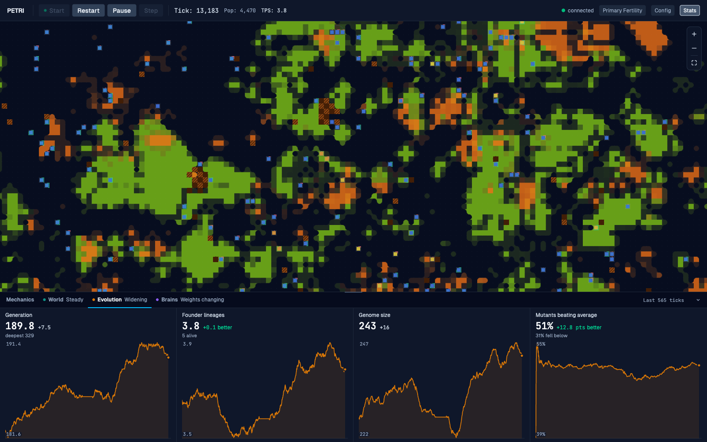

The top bar starts, pauses, steps and restarts the world and shows the tick,
population and ticks per second. The map draws food, fertility and barriers
in cached layers and creatures live on top, gliding between ticks. Zoom runs
from the whole world down to single cells. While the world is paused,
**Paint** draws or erases barriers and food by hand. **Primary Fertility**
overlays the fertility map of the main food. Click any creature to inspect it.

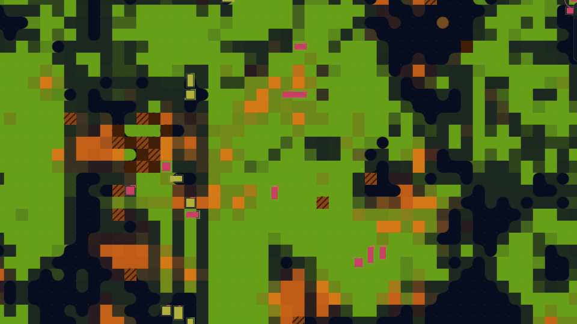

<sub>The same run near tick 17,500, zoomed closer. By then a magenta lineage
had become common. Rose rings mark a creature striking a neighbor to steal
its energy.</sub>

### Creature inspector

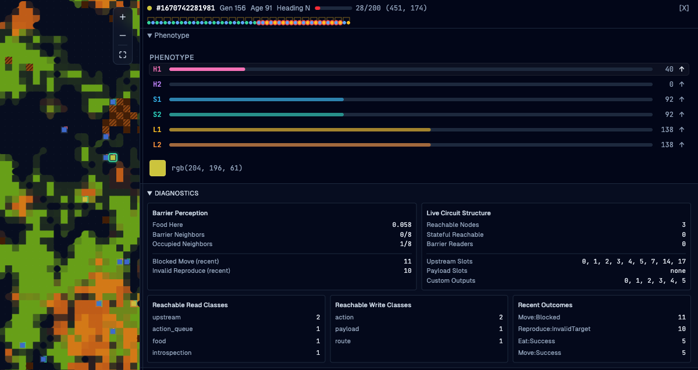

Clicking a creature opens its inspector beside the map. The top strip gives
its id, generation, age, heading, energy and position, and a row of dots for
its recent actions. **Phenotype** shows the six color genes and the color
they produce. **Diagnostics** reads its circuitry against what it has been
doing: what it perceives of nearby barriers and food, which brain nodes can be
reached, which kinds of input they read and output they write, and how its
recent actions turned out.

### Brain mesh and node inspector

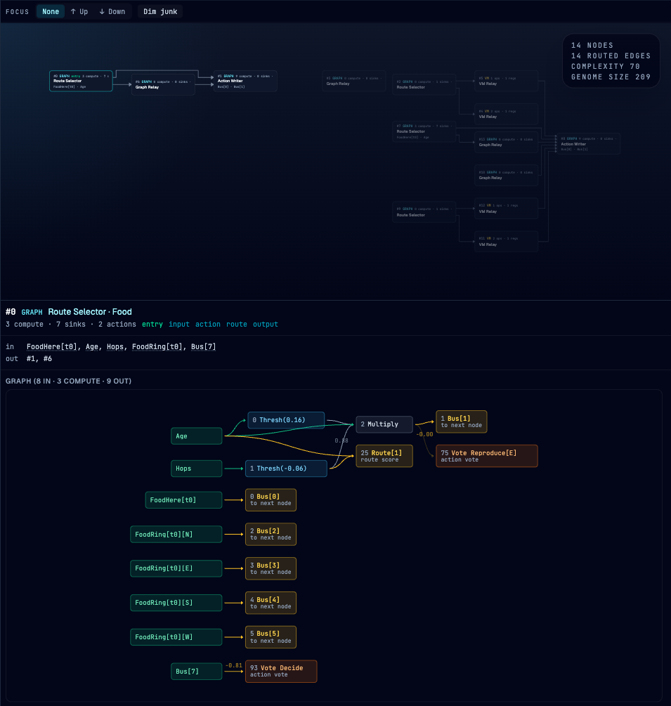

Below the cards the brain is drawn as a mesh of nodes joined by routed edges.
Each node is either a small weighted graph or a tiny virtual machine program.
**Focus** highlights everything upstream or downstream of the selected node,
and **Dim junk** fades the nodes no input can reach. The badge counts nodes, routed edges,
complexity and genome size.

Selecting a node opens it underneath: its kind and role, its flags (entry,
input, action, route, output, stateful), the senses and bus slots it reads,
the nodes it feeds, and its insides. A graph node draws its own wiring from
inputs through compute nodes to bus writes, route scores and action votes,
with each weight on its edge. A VM node shows its program.

### Edges, groups and learning

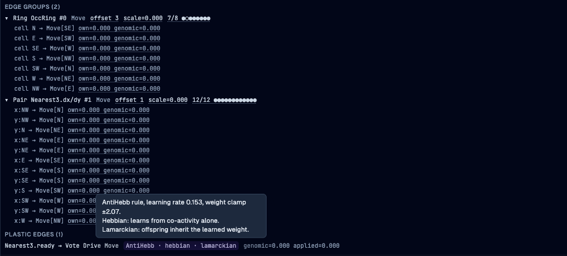

Edges are first-class: hover one for its source, target and weight. Edge
groups wire a whole family of senses at once, such as the eight cells of a ring
around the creature, through a shared scale and a pattern, and each member's
weight is that scale times its pattern plus its own correction. Plastic edges learn during a creature's life;
their tooltips give the rule, learning rate and weight clamp, whether learning
follows co-activity or reward, and whether offspring inherit the learned
weight (Lamarckian) or the weight it was born with (Darwinian).

### Tick sampler

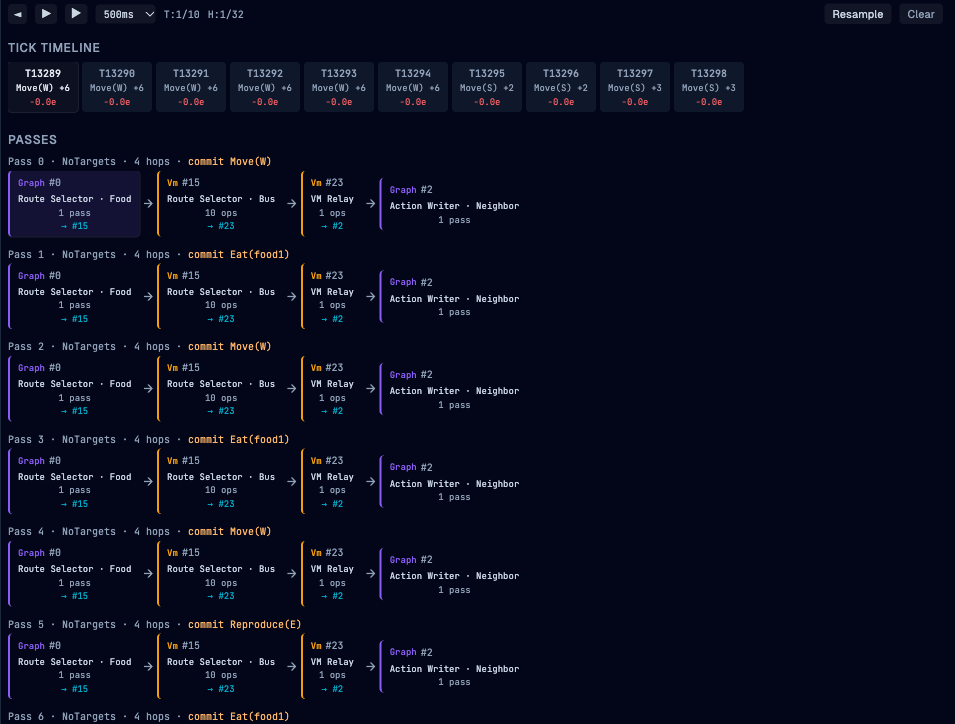

**Sample 10 Ticks** records the selected creature's next ten ticks. The timeline
lists each tick's actions and energy change. Under it, each pass through the
brain is drawn as the chain of nodes it hopped through and the action it
committed, and the same path is traced on the mesh above as you step or play
through the sample.

### Statistics dock

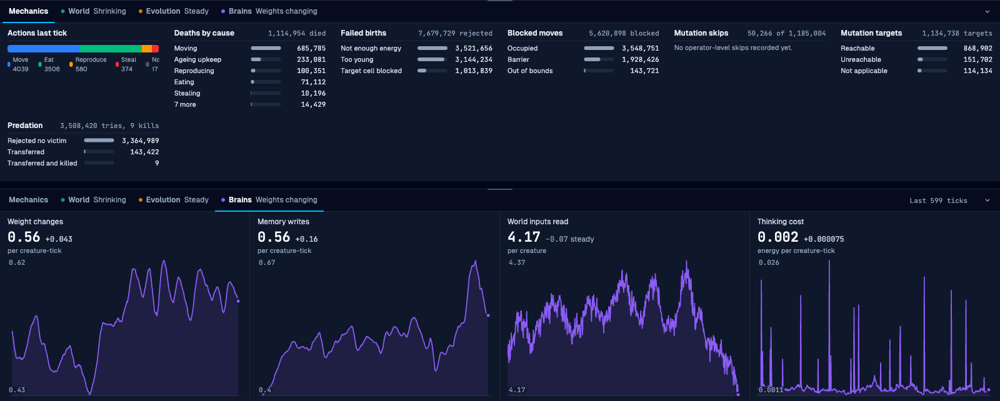

The dock under the map follows the whole population. **Mechanics** counts what
the rules did: last tick's actions, deaths by cause, failed births, blocked
moves, predation and mutation. **World** (creatures, births and deaths, energy,
food), **Evolution** (generation, founder lineages, genome size, mutants that
beat the average) and **Brains** (weight changes, memory writes, world inputs
read, thinking cost) chart about the last 600 ticks, and each tab names the
trend it sees.

### Config panel

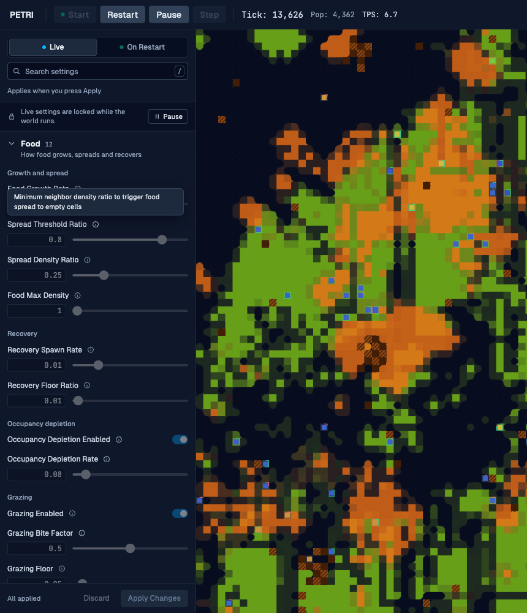

Every parameter is searchable and explained in place. **Live** settings change
the running world: pause, edit and press Apply. **On Restart** settings shape
the next world: seeds, founders, map size and edges, terrain, food types and
fertility. Worlds save and load as JSON recipes.

## Telemetry

Runs export metrics, traces and logs over OpenTelemetry to one local
`grafana/otel-lgtm` container ([`telemetry/compose.yaml`](telemetry/compose.yaml)).
Grafana provisions four Petri dashboards and serves two report pages. The
captures below are from the same Confluence run as the animation; the flat
stretch near the end is where I paused it to take the inspector screenshots.

### Run dashboard

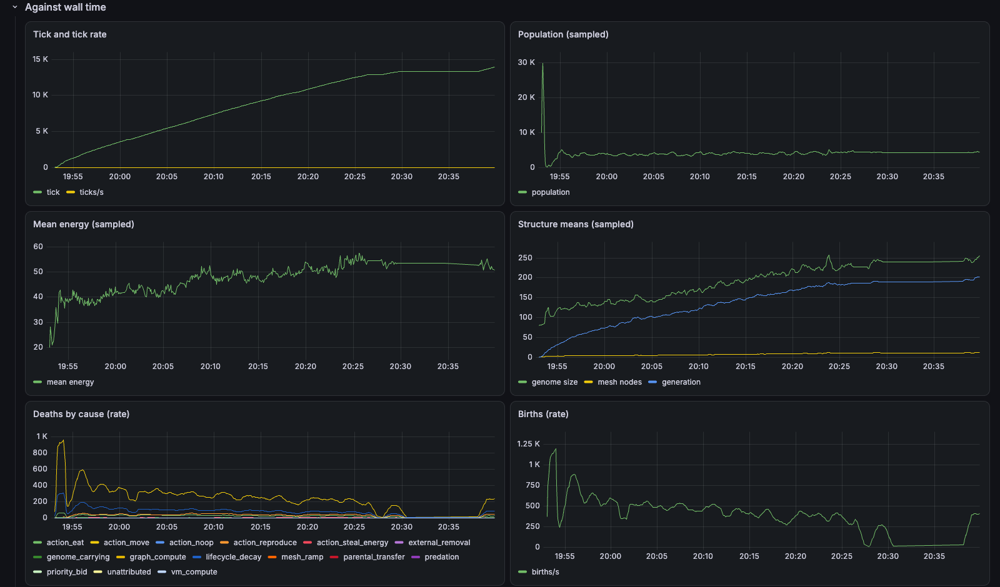

**Petri / Run** follows one run against wall-clock time: tick rate,
population, energy, genome size and brain nodes, deaths by cause, births,
mutation events, energy flows and actions per tick. Its first panel holds the
run's identity: the full config and build. **Petri / Runs** lists every run
with its seed, world and build.

### Performance dashboard

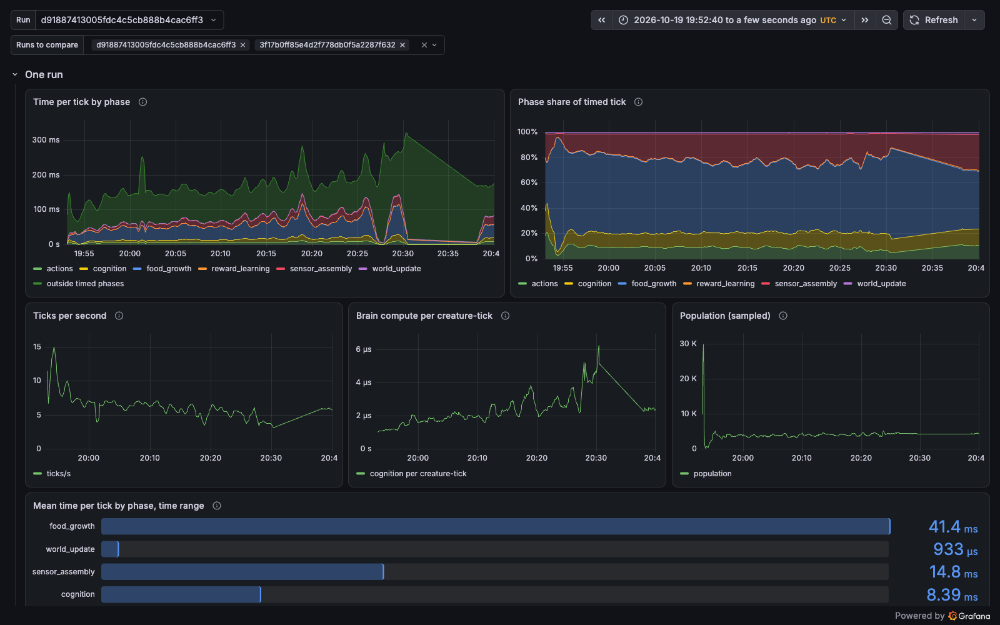

**Petri / Performance** splits each tick into its phases (food growth, sensor
assembly, cognition, learning, actions, world update), tracks ticks per second
and brain compute per creature-tick, and compares the phase costs of several
runs.

### Compare runs

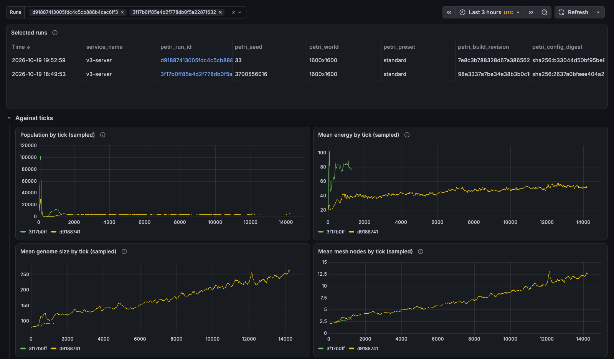

**Petri / Compare runs** lines up any set of runs on a shared tick axis:
population, energy, genome size, brain nodes, births and deaths, behavior
totals, eating success by food type, and offspring per creature by kind of
brain.

### Creature window reports

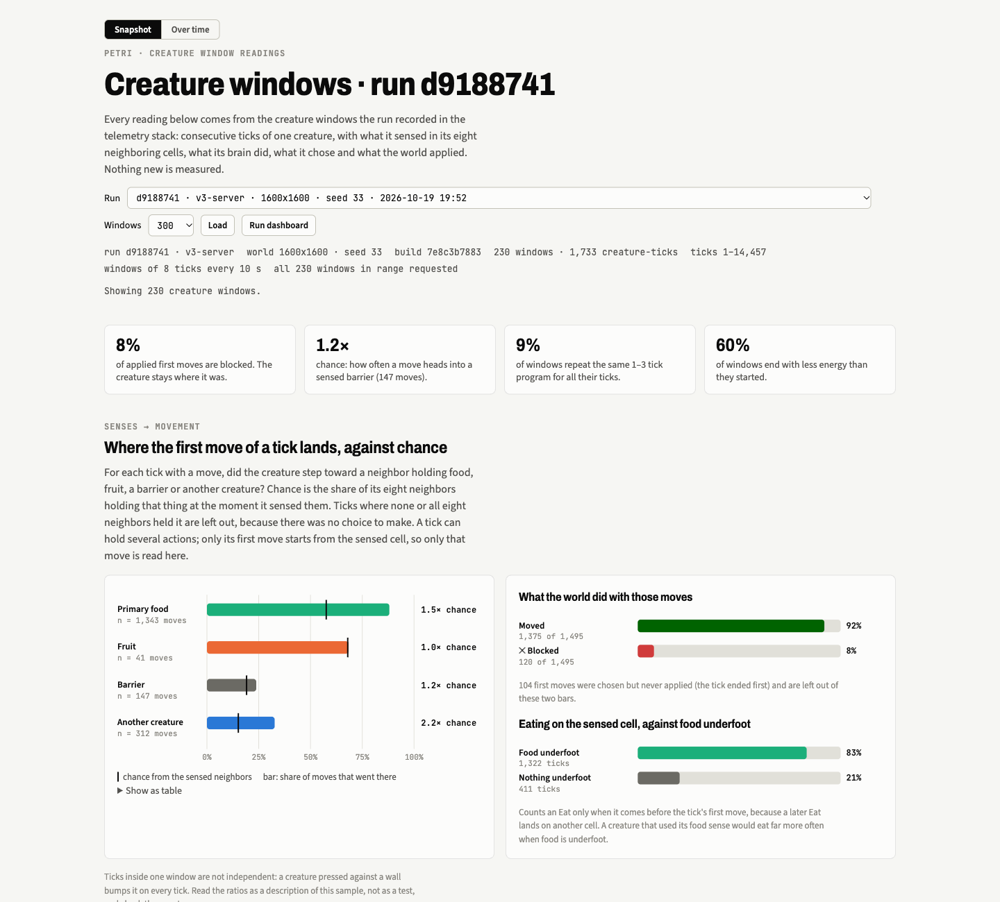

While a run is going, the server records short creature windows: eight
consecutive ticks of one creature with what it sensed in its neighborhood,
what its brain did, what it chose and what the world applied. **Creature
windows** asks whether that behavior beats chance: does a creature step toward
the food, fruit, barriers or other creatures it senses more often than a random
step would; how many creatures run a fixed program whatever they sense; how
much of the brain takes part in a decision. It ends with a tick-by-tick viewer
for any window.

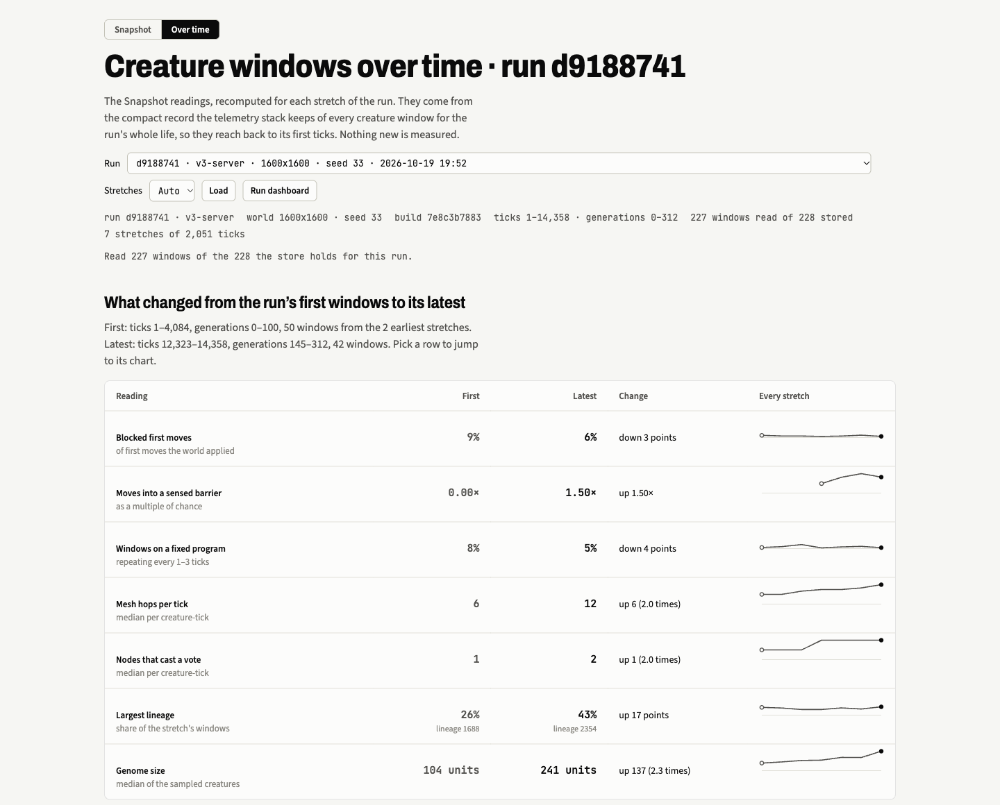

**Creature windows over time** recomputes those readings for each stretch of
the run and sets the first windows against the latest. In this run, between
the first 4,000 ticks and ticks 12,300 to 14,400, decisions began to use twice
as many brain hops, genomes grew from 104 to 241 units, and one lineage grew
from 26% to 43% of the sampled creatures.

## Progress record

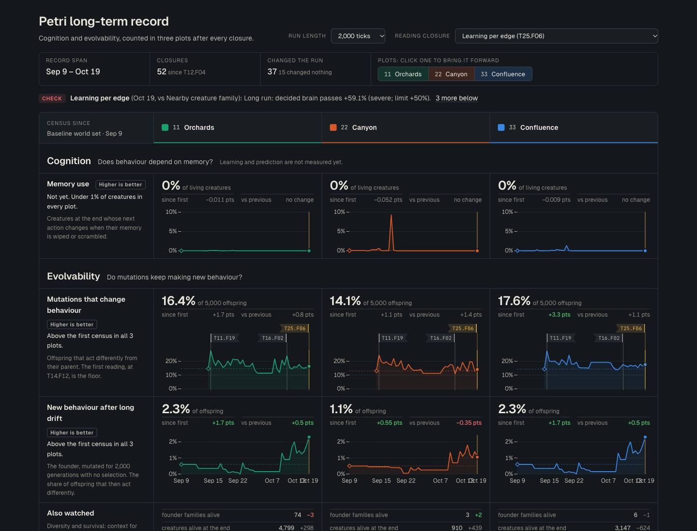

Every roadmap feature closes with a deterministic benchmark on three fixed
worlds: Orchards (seed 11), Canyon (seed 22) and Confluence (seed 33). The
[progress page](docs/progress/index.html) reads those stored summaries as a
long-term field record. Each world gets a column of cognition and
evolvability readings with their change since the first census and since the
previous closure and a curve across every closure, followed by compute cost,
a register of closures and charts by topic. To view it, serve `docs/` locally:

```sh
python3 -m http.server --directory docs 8000
```

Then open <http://localhost:8000/progress/>.

## Verification

Run `make check` before completing application, runtime or build-configuration
changes; documentation-only work uses `make check-docs`. `make audit` performs
the explicit full-history secret scan. `make rust-check` runs format
validation, the viability merge gate, `make rust-test-all` and Clippy; CI fans
the named test targets out in parallel. `make help` lists every target.

## Documentation

- [Documentation index](docs/README.md)
- [Roadmap](docs/roadmap.md) and [execution workflow](docs/workflow.md)
- [Saved worlds](experiments/worlds/README.md)
- [Contributing](CONTRIBUTING.md)
- [Security](SECURITY.md)
- [Changelog](CHANGELOG.md)
