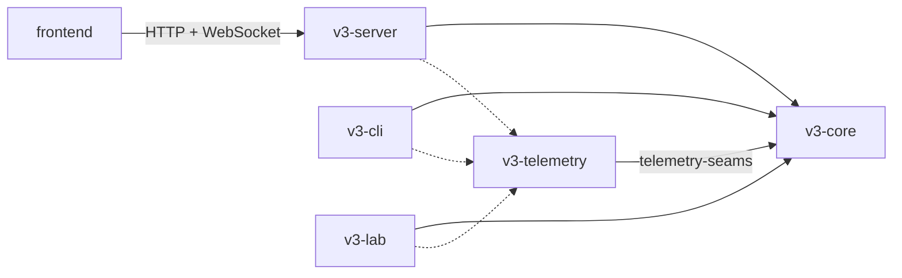
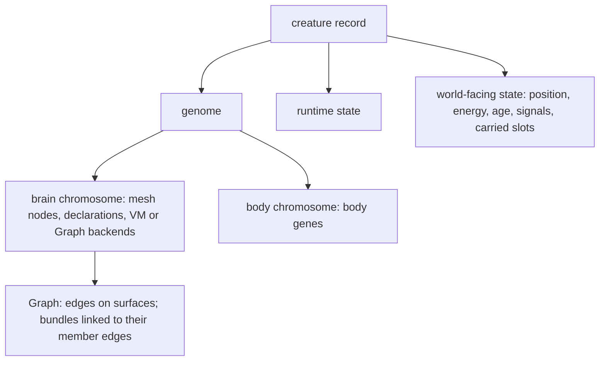

# Petri architecture

**State**: desired. This file describes where the system is going, not what
the code does today. [Known debts](#5-known-debts) lists where the code
differs and the row that pays each debt.
**Last updated**: 2026-10-25

## Use this file

1. **Plan**: read it; a spec names the owners it touches and any boundary it
   changes. Work that changes the desired architecture edits this file in
   the same change.
2. **Implement** toward it, never toward a shape listed as a debt.
3. **Review**: a diff that introduces or widens coupling this file forbids
   is a finding; unchanged existing debt is not. A row the priority order
   places before a debt's payer may extend that debt in its present shape,
   inside the modules the debt names, with a `WORKAROUND(<debt id>)`
   comment at the site naming the row that pays it; that extension is not a finding, and any other
   widening is.
4. **Close**: delete the debts the feature paid.

The workflow says how ([Plan, Review, Close](workflow.md)). Design detail
belongs in the rows and specs that implement it; this file links to them.

## 1 Rules

1. **One owner per concept.** Its module owns the rules for building,
   validating, editing and interpreting it, and callers use its operations
   or resolved views. Invariant-bearing state stays private and compound
   changes are complete owner operations: callers supply choices, never
   assemble shared rules through low-level writes.
2. **Dependencies point down, with no cycles** (section 3's order and
   prohibitions).
3. **Composition over inheritance.** Aggregates are composed of parts; a
   variation is a closed enum whose behavior lives in one module, or one
   value type reused in several slots; no trait hierarchies for domain
   objects.
4. **Sampling apart from application.** Mutation samples; the owning domain
   validates and applies deterministically.
5. **Genes, inherited payload and runtime state stay apart.** Derived data is
   computed from the genome and never stored in the genome type; when it is
   computed (once per birth, or per edit) is the owning row's choice.
6. **Observations derive from applied behavior**, and outer crates own
   transport and export.

The design principles behind them (fewest assumptions and most
evolvability inside clean layers, a natural analog for every mechanism, no
backward compatibility) are the [master roadmap's standing rules](roadmap.md).

## 2 System

| Part | Owns | Never |
| --- | --- | --- |
| `v3-core` | the simulation library | I/O, transport, telemetry export, a dependency on another workspace crate |
| `v3-telemetry` | run identity and OTLP export, read through `telemetry-seams` | changing a run or drawing a simulation RNG |
| `v3-cli` | commands, benchmarks, measurements | simulation rules |
| `v3-server` | transport, sessions, query projections (the inspector's brain view among them) and its own wire types | simulation rules; core structs on the wire other than `Direction`, `Position`, the id types and the config schema |
| `v3-lab` | capability assays ([lab contract](lab.md)) | being depended on; anything reaching production |
| `frontend` | rendering and controls over the server API ([frontend rules](../frontend/AGENTS.md)) | copying a core type by hand or recomputing a simulation rule |

The genome and runtime resolve what the inspector shows through their own
read APIs; the server only selects, structures and serializes it, and the
frontend's types are generated from or tested against the server's.

## 3 Core domains

From the bottom up; a domain imports only domains below it, and never one
on its own row:

1. `contracts`
2. `config`, energy ledger (`ledger/`)
3. world (`kernel`)
4. `patterns`
5. genome (`genome/`)
6. `sensors`
7. `mutation`, `runtime`
8. `creature`
9. `simulation`
10. readers (`neighborhood/` and the census modules `plasticity_census`,
    `sensor_census`, `drives` and `ring_rules`)

The order already rules out `mutation` and `runtime` importing each other,
`runtime` importing `simulation` or the creature record, and simulation
behavior depending on readers. Two prohibitions it does not say:

- The genome imports nothing but `contracts`.
- Sensors never read the genome or a whole creature, by import or by field
  access through another type; they get explicit views and a
  perception-requirements value.

| Concept | Owner |
| --- | --- |
| shared vocabulary: ids, directions, actions, sensor descriptors (fields, field sets, geometry), the brain I/O catalog (action kinds, vote sinks, parameters, widths derived from it), the applied action result (outcome kind and attempt effort); values, and pure functions over them, that no domain above owns (deterministic hashing among them). Behavior a domain owns never moves here to dodge the order | `contracts` |
| configuration schema, pattern parameters included | `config` |
| energy and material accounting primitives (death cause, debits, cognition energy; carried-stock, overflow and destruction records from T28.F01) | energy ledger (`ledger/`) |
| world state and world-edit primitives | world (`kernel`) |
| genome structure: chromosomes, nodes, declarations, edges, bundles and wiring; edits that validate and return their effects on inherited values; deterministic analysis, the learning layout among it | genome (the Graph is the aggregate root of edges and bundles) |
| mutation supply, dispatch and every birth draw | `mutation` (samples; owners apply) |
| perception | `sensors` |
| brain execution, its state, learned values and the learning update law | `runtime` |
| the creature record, body rules, and one birth constructor for founders and children (finalization, inherited payload, per-life initialization, energy provisioning) | `creature` |
| tick order; action resolution, each action one transaction with one applied result; removal settled through one path; records derived from applied results | `simulation` (a scheduler and mechanics) |
| censuses and indicators | readers (`neighborhood/`, the census modules) |
| transport, the inspector view, telemetry export | outer crates (section 2) |

## 4 Composition and flow

- **Tick**: `food_growth` → `world_update` → `sensor_assembly` → `cognition`
  (parallel, world frozen) → `actions` → `reward_learning`. The scheduler
  owns the order; mechanics commits actions; runtime updates learning.
  Feature timing contracts (signal visibility, delivery) live in their rows.
- **Birth**: the birth constructor drafts the child (genome, mutation,
  inherited payload, provenance) and finalizes it; the simulation supplies
  world context. Design: [T29](roadmaps/t29-heredity.md).
- **Mutation**: the engine dispatches each event to an operator, which
  samples one edit; the genome validates and applies it. Sensor wiring:
  [T25.F11](roadmaps/t25-edge-groups-and-learning.md).
- **Learning**: genome learning settings → learning layout (once per birth)
  → runtime values and update law. Design: T25.F12.

## 5 Known debts

Where today's code differs from sections 1–4, with the row that pays it.
Delete a line when the code matches. Rows name modules and symbols, not
lines; `scripts/architecture-debts.txt` is the one line-level list.
`scripts/architecture-check.mjs` (in `make check-docs` and `make check`)
fails any `v3-core` import against section 3, through `crate::`, `self::`
or `super::` paths and grouped `use` trees, except those
`scripts/architecture-debts.txt` lists under a debt here, and fails a listed
import the code no longer needs. It also fails an import of a module no domain
owns, anything but module declarations in `v3-core`'s `lib.rs`, and any crate
depending on `v3-lab`. Debts outside `v3-core` imports (the wire,
the frontend, binaries) are checked by review only. Design notes:
[sensor wiring](strategy/group-creation-unification-2026-10-22.md),
[bundle learning](strategy/bundle-learning-ownership-2026-10-22.md),
[heredity](strategy/heredity-architecture-2026-10-22.md).

| Debt | Today | Paid by |
| --- | --- | --- |
| G1 | Three routes wire a sensor with three rule sets (`mutation::input_ref`, `mutation::graph::recruitment`, `mutation::graph::group`); fact-only branches and split hosting in `creature::genome::cgp::container`; non-world sensor widths in `mutation::compound` | T25.F11 |
| G2 | Brain I/O vocabulary outside `contracts` (`creature::genome::vote`, outcome channels read by `sensors::static_inputs`, `OUTPUT_SLOT_COUNT` in `runtime::types` imported by `mutation::sampling`); route resolution and jump targets imported from runtime (`mutation::topology::routing`, `mutation::vm::operators`) | vocabulary: T25.F11; routes and jumps: T30.F05 |
| G3 | Learning configured on edges only (the genome's edge type), group flags beside it (`creature::genome::cgp::group`), `Scope::Group` branches in `runtime::plasticity::learned`, learners found from plastic edges (`creature::genome::companions`) | T25.F12 |
| G4 | No birth constructor: `spawn_child` (`simulation::actions::reproduction`) and `simulation::seeding` build creatures separately; learned seeds ride in the genome (`creature::genome::cgp::container`); `cap_energy` runs after construction; traits draw their own RNG (`creature::identity`, `creature::body`) | T29.F01 |
| G5 | Body outside the genome (`creature::body`), per-birth trait chances, colour and kin tag gated on brain mutation (`simulation::actions::reproduction`), `lineage_id` in the body (`creature::identity`), mutation importing creature's `Phenotype` (`mutation::phenotype`) | T29.F02 |
| G6 | Every memory slot passes to the child (`simulation::actions::reproduction`) | T29.F03 |
| G7 | Energy primitives (`DeathCause`, debits, cognition energy) in `simulation::energy_accounting`, imported by runtime (`runtime::{mesh, vm, cgp::execute, types, trace}`) and the creature record (`creature::state`) | T30.F02 |
| G8 | Runtime state types in the creature record (`creature::state`), imported by runtime (`runtime::{mesh, cgp::execute, cgp::traced, traced_mesh}`) and mutation (`mutation::reachability`, through `DispatchRecord`) | T30.F02 |
| G9 | Sensors read the whole creature and its colour helper (`sensors::{reducers, static_inputs}`) while the creature record imports `sensors::reads` (`WorldKeySet`) | T30.F03 |
| G10 | A config→patterns→kernel cycle (`config::simulation`, `patterns`, `kernel::fertility`) | T30.F04 |
| G11 | The kernel imports a creature hash helper (`kernel::ordinary_food::stream`) | T30.F04 |
| G12 | The genome validity gate lives in `creature::parseability`, imported by `mutation::engine` | T30.F05 |
| G13 | The InputRef mutations edit declarations and Graph edges by hand (`mutation::input_ref`) | T25.F11 |
| G14 | Production reads readers: sensor caches computed by a census at construction (`creature::state`); the inheritance witness reads `creature::drives::PATH_WEIGHT_FLOOR` (`simulation::actions::reproduction`) | caches: T30.F03; witness: T25.F11 |
| G15 | Genome analysis draws randomness (`creature::genome::analysis`, called by `mutation::vm::operators`) | T30.F05 |
| G16 | A runtime trace carries simulation and creature records (`runtime::trace::domain`) | T30.F02 |
| G17 | The genome's internal layout is the frontend's API (`v3-server`'s creature response, `transport::sample_assembler`); `frontend/src/types/genome.ts` copies genome types by hand and inspector files recompute genome rules | T30.F01 |
| G18 | Two result vocabularies: `ActionResult` (`creature::action_log`) and a success boolean for rewards (`simulation::outcomes`) | T30.F06 |
| G19 | Action resolution mixed with scheduling: per-action executors, action flooring and removal in `simulation::tick` beside `run_tick`; mechanics taking the whole `Simulation` (`simulation::actions::{giving, predation}`); move effort composed on the creature record (`creature::state`) | T30.F06 |
| G20 | Sensors read the genome to decide what to assemble (`sensors::{perception, typed_food}`) | T30.F03 |
| G22 | Core structs on the wire outside section 2's exemption: the action log (`ActionLogEntry`, `ActionResult`, `ActionType` in `v3-server`'s creature response) and paint (`PaintTool`, `PaintStats` in its paint API); `frontend/src/types/action-log.ts` and `paint.ts` copy them by hand | action log: T30.F06; paint: T30.F01 |
| G23 | Program edits applied in mutation: splice and insertion with jump-reference repair (`mutation::vm::operators::splice_program_with_reference_repair`, also used by `mutation::topology::routing`) and the register-count resize with its width predicate (`register_count_moves`, `apply_register_count_mutation`) | T30.F05 |
| G24 | The genome lives under the creature record (`creature/genome/`), and the import checker special-cases that path | T30.F07 |
| G25 | A profiling binary with file I/O in the core crate (`v3-core/src/bin/profile_ticks.rs`), which the import checker skips | T30.F07 |
