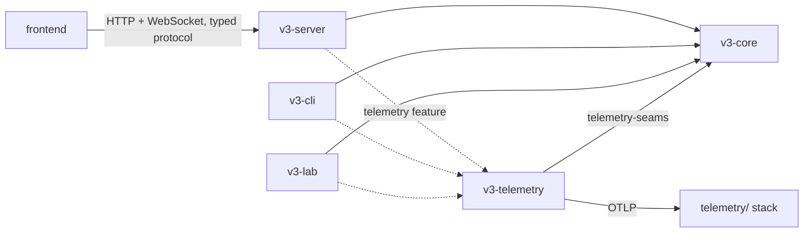
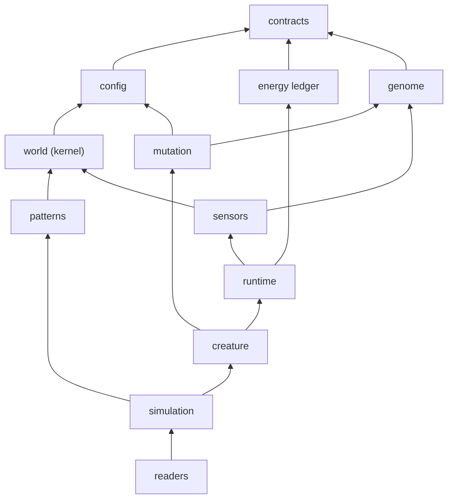
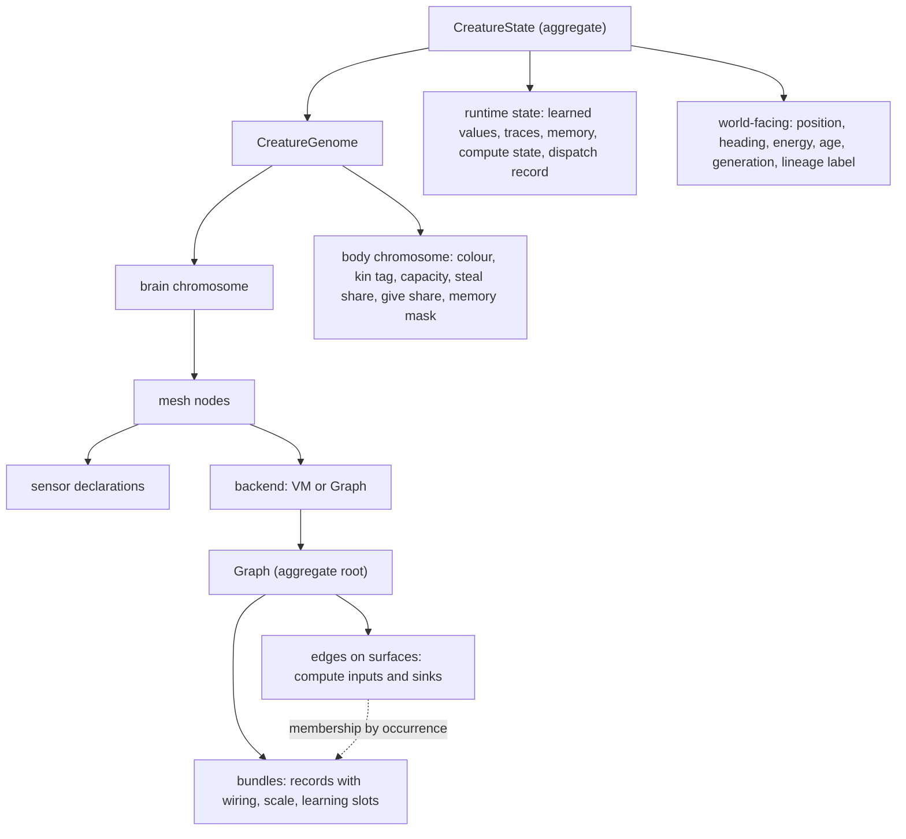
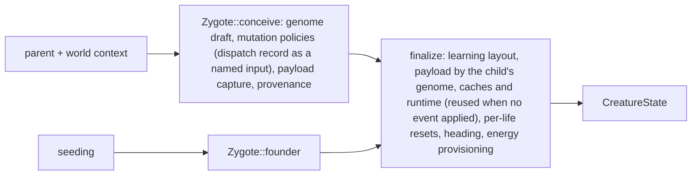

# Petri architecture

**State**: desired. This file describes where the system is going, not what
the code does today. [A8 Gaps](#a8-gaps) lists every place the code differs
and the roadmap row that closes it.
**Last updated**: 2026-10-22

## Use this file

1. **Plan** a track, row or spec: read A1–A7 and cite the sections the work
   touches and the A8 gaps it closes or preserves. Work that changes the
   desired contract (A1–A7) edits this file in the same change and adds an A8
   line naming its row; work the desired state already allows only cites it.
2. **Implement** toward the cited sections, never toward a shape A8 lists as
   today's.
3. **Review**: a change that adds an import A3 does not allow, gives a concept
   a second owner (A5) or leaks one domain's internals into another is a
   finding. Code that already used an A8 gap is pre-existing; a new use of a
   gap is added coupling unless the spec declares it with the gap's owning
   row ([Review](workflow.md#review) grades both).
4. **Close**: delete the A8 lines, or parts of lines, the feature closed. A8 is
   empty when the code matches this file.

The workflow enforces each step: [Plan, Review, Close](workflow.md). Sections
keep their `A` numbers so specs can cite them; gaps keep their `G` numbers
until deleted. How the code drifted lives in the strategy notes A8 links,
never here.

## A1 Rules

| Rule | Here |
| --- | --- |
| One owner per concept | One module builds, validates and edits a concept; every route to it calls that owner. Two routes never carry two rule sets. |
| Dependencies form a graph | A3's arrows are the allowed imports. No cycle between domains; siblings with no path between them never import each other. |
| Composition over inheritance | Aggregates are composed of parts (genome = brain + body chromosome; creature = genome + runtime + world-facing state). Variation is a closed enum with its behavior in one module (`Wiring`) or one value type reused in several slots (`Learning`); no trait hierarchies for domain objects. |
| Fewest assumptions, most evolvability | When two designs are plausible, make both evolvable (live and silent births, two learning slots), inside clean layers. |
| Sampling apart from structure | Mutation samples; the owning domain validates and applies deterministically. A birth's randomness lives only in mutation policies. |
| Derive, don't duplicate | Analysis results (learning layout, caches) derive from the genome once per birth and are never stored in the genome type. Runtime state and telemetry derive from applied behavior. |
| Natural analog | Every mechanism names one ([master roadmap](roadmap.md)). |
| No backward compatibility | Genomes, configs and pins move when the design moves, predeclared. |

## A2 System

| Part | Owns | Never |
| --- | --- | --- |
| `v3-core` | the simulation library: world, genome, mutation, runtime, creatures, readers | I/O, transport, telemetry export, lab selection, a dependency on another crate here |
| `v3-telemetry` | run identity, OTLP export, metrics, traces and windows read through `telemetry-seams` | changing a run or drawing a simulation RNG |
| `v3-cli` | commands, benchmarks and measurements (`bench`, `measure`, `inspect`) | simulation rules |
| `v3-server` | HTTP and WebSocket transport, sessions, query projections (the creature inspector's brain view among them), its own wire types | simulation rules; a core struct reused as a wire shape beyond the shared shapes below |
| `v3-lab` | capability assays under the [lab contract](lab.md) | being depended on; lab selection, tasks or solutions reaching production |
| `frontend` | rendering and controls over the typed server API ([frontend rules](../frontend/AGENTS.md)) | fabricating runtime state |

**Shared shapes.** Transport may carry two core shapes as they serialize:
contracts values (directions, positions, ids) and the config schema (a recipe
is that schema). Everything else, the genome included, reaches the frontend
through a projection `v3-server` owns, which resolves the facts the frontend
shows (composed weights, patterns, learners) so no frontend code recomputes a
genome rule; the frontend's types are generated from that projection or held
by a field-by-field parity test, never a hand copy. Telemetry
may also export the genome's canonical serialization as an identity record
for tools, never for the frontend.

## A3 v3-core domains

An arrow means "may import". A domain may import every domain it reaches by
following arrows, and none that reaches it back. The unit is the domain, not
the module path: `creature/genome/` is the genome domain, so
`crate::creature::genome` is a genome import.

| Domain | Owns | Today |
| --- | --- | --- |
| contracts | shared vocabulary: ids, positions, directions, world actions, action queue, routing; **sensor descriptors** (fields, field sets, geometry, descriptor-to-source addressing); **brain I/O vocabulary** (vote sinks: four directed kinds of nine plus `Eat`, `Terminate`, `Decide`; action parameters; output slot count); the parent dispatch-history view mutation reads; deterministic hashing | `contracts/`; G1, G2, G8, G11 |
| config | configuration schema and defaults, pattern parameters included | `config/`; G10 |
| energy ledger | energy-accounting primitives the runtime, creature and simulation share: death cause, debit and observation helpers, cognition energy observation | G7 |
| world (kernel) | grid, food resources, fertility, occupancy, paint | `kernel/` |
| patterns | world pattern generators | `patterns/` |
| genome | heritable data and its deterministic analysis: A4's chromosomes, edit transactions, wiring, structural annotations (declared and wired sensor keys among them), validity, the learning layout | `creature/genome/`; G12, G15 |
| mutation | supply law, event dispatch, operators and birth policies; samples edits and calls genome edit APIs | `mutation/`; G2, G13 |
| sensors | perception assembled from the world and creature-visible views passed in explicitly | `sensors/`; G9 |
| runtime | brain execution: mesh pass loop, VM, graph evaluation, vote selection, action decode, plasticity values and update law, its own state types, brain-execution traces | `runtime/`; G7, G8, G16 |
| creature | the `CreatureState` aggregate, body rules (move factor, upkeep, energy scale, energy cap), founders, the birth transaction | `creature/` outside `genome/`; G4, G8 |
| simulation | tick order and phases, action resolution (move, eat, predation, giving, delivery), seeding with world context, outcomes, run totals | `simulation/` |
| readers | censuses and indicators over structural and runtime views; nothing in production depends on them | `neighborhood/`, `creature/*_census.rs`, `creature/drives.rs`, `creature/ring_rules.rs`; G14 |

## A4 Creature composition

- `genome_size` = brain units + body units: one explicitly defined economic
  measure that drives costs and mutation supply.
- A bundle never stores its members: a member is an edge linked to the bundle
  record by its occurrence (surface and position). The Graph is the one
  structural owner.
- A member's weight is `scale × pattern + modifier` for every wiring.

## A5 Owners

| Concept | Owner | Never |
| --- | --- | --- |
| sensor fields, field sets, geometry | contracts sensor descriptor | rediscovered by mutation, wiring or readers |
| vote and action vocabulary | contracts brain I/O | defined inside one backend |
| declaration–use cross-references on a node | the node's edit transaction | kept by hand inside a mutation category |
| edges | Graph backend, through its edit transactions (validation, stable learnable ids) | edited outside the container |
| learnable identity | Graph edits keep a stable id per edge and bundle (kept by copies, fresh on creation, dropped on removal); the learning layout exposes it | edge indices as keys across edits |
| bundle and membership | Graph backend: bundle record, member link by occurrence | a bundle holding its members |
| wiring (`Plain`, `Ring`, `DirectionPair`) | genome: closed enum; member coordinates, pattern, destination requirements, plan enumeration and legality in one module | the input contract knowing which action receives a field |
| learning settings | one `Learning` value type: lone edge `Option<Learning>`; bundle `scale_learning` and `member_default`; member policy `Inherit`, `Static` or `Own` plus `credits` | per-edge-only config; parallel flags for one idea |
| learning layout (learners, identities, effective `Learning`, contributors) | genome analysis, once per birth after mutation | runtime discovery; edge-only discovery; per-visit `Inherit` lookup |
| learned values, traces, update law | runtime plasticity | genome type |
| mutation supply | mutation engine: `Binomial(units, rate)` per chromosome, one rate | a per-trait chance |
| event dispatch (Topology, VM, Graph, InputRef, Body) | mutation engine: selection only | owning data or invariants |
| birth randomness (live or silent, learning draws, trait steps) | mutation policies | a trait drawing its own RNG |
| offspring construction | creature birth transaction: draft (`Zygote::founder`, `Zygote::conceive`), then finalize | the simulation layer; a second builder |
| birth payload (learned seeds keyed by learnable identity, parent memory) | birth transaction | the genome type |
| parent dispatch history | runtime records it; the birth transaction hands mutation a contracts-level view of it as a named input | mutation importing runtime or the aggregate |
| inherited-store policy | each store, read from the child's genome: seeds by `Learning.lamarckian`, memory slots by mask bit | one universal rule |
| provenance (parent, generation, lineage label) | the zygote; the lineage label is observation-only | the body |
| energy cap and provisioning at birth | birth finalize | after construction |
| energy debit and death cause | energy ledger | simulation-owned types imported by runtime |
| world state | world (kernel) | |
| perception | sensors | a sensor reading the whole aggregate |
| tick order and action resolution | simulation | |
| traces | runtime owns brain-execution traces; simulation composes tick records (action outcomes, phase timings) around them | runtime types carrying simulation or aggregate records |
| telemetry export | `v3-telemetry` through `telemetry-seams` | core code exporting |
| wire shapes | `v3-server` transport | core structs on the wire |

## A6 Flows

**Tick.** `food_growth` → `world_update` → `sensor_assembly` → `cognition`
(parallel, world frozen) → `actions` → `reward_learning`. Simulation owns the
order; each phase calls one domain's API.

**Birth.**

**Mutation.** The engine draws events per chromosome, dispatches each to a
category, and the operator samples one edit. For a new sensor or bundle the
birth policy asks the Graph for the admissible wiring plans, samples one and
draws the birth law and learning; the Graph validates and applies the plan
atomically.

**Learning.** Genome `Learning` settings → learning layout (pure, once per
birth) → runtime values and update law (contribution aggregation, then one
scalar update per learner). Readers read the layout.

## A7 Boundary rules

Reviewers cite these by number.

1. Imports follow A3; no import cycle between domains (A3's unit).
2. `genome` imports only `contracts`.
3. `mutation` and `runtime` never import each other; `sensors` imports neither
   `runtime` nor `creature`.
4. Each concept in A5 has its one owner; a new route to it calls that owner.
5. Mutation samples, owners apply; no birth randomness outside mutation
   policies.
6. Derived data never lives in the genome type; runtime state and telemetry
   derive from applied behavior.
7. Simulation rules, energy accounting, telemetry, transport, I/O and
   configuration parsing stay apart; telemetry and test-only hooks sit behind
   `telemetry` and `telemetry-seams`.
8. A2's crate rules: `v3-core` depends on no other workspace crate; lab code
   never reaches production. An internal struct reused as a transport or
   telemetry shape beyond A2's shared shapes, or a field read raw at many sites where one resolver
   belongs, is a boundary finding.

## A8 Gaps

Reconciliation, not history. Each line is a difference between today's code
and A1–A7, with the row that closes it. Delete the line when the code matches.
Design notes: [sensor wiring](strategy/group-creation-unification-2026-10-22.md),
[bundle learning](strategy/bundle-learning-ownership-2026-10-22.md),
[heredity](strategy/heredity-architecture-2026-10-22.md).

| Gap | Today | Desired | Closed by |
| --- | --- | --- | --- |
| G1 | Three routes wire a sensor with three rule sets: `mutation/input_ref/mod.rs:310` `apply_add`, `mutation/graph/recruitment.rs:125` `Admission`, `mutation/graph/group.rs:121,159`; fact-only branches in `creature/genome/cgp/container.rs:695` `pattern_at` and `:1304` `detach_at`; hosting split into `:1105` `can_host_group` (every directed kind's direction sinks) and `:1117` `can_host_facts`; non-world sensor widths in `mutation/compound.rs:21-24` | A5 wiring, bundle, sensor descriptor | T25.F11 |
| G2 | Brain I/O vocabulary outside contracts: votes in `creature/genome/vote.rs`; `OUTPUT_SLOT_COUNT` in `runtime/types.rs`, imported by `mutation/sampling.rs:7`, `mutation/graph/recruitment.rs:16`, `mutation/input_ref/mod.rs:16`; route resolution and jump targets imported from runtime by `mutation/topology/routing.rs:12` and `mutation/vm/operators.rs:728` | A3 contracts; A7 rule 3 | the vocabulary the sensor descriptor needs (vote and outcome counts, output slot count): T25.F11; route resolution and jump targets: T30.F05 |
| G3 | Learning configured on edges only (`creature/genome/mod.rs:180` `PlasticityConfig`); group `inherit_scale` and `retention` beside it (`creature/genome/cgp/group.rs:122`); `Scope::Group` branches in `runtime/plasticity/learned.rs:166-278`; learners discovered from plastic edges (`creature/genome/companions.rs:57`, `learned.rs:563`) | A5 learning settings, learning layout | T25.F12 |
| G4 | No birth transaction: `spawn_child` in `simulation/actions/reproduction.rs:376` coordinates a birth; `simulation/seeding.rs:95` is a second builder; learned seeds ride in the genome (`creature/genome/cgp/container.rs:245-246`, captured by `simulation/actions/cgp_reproduction.rs:15`); `cap_energy` runs after construction (`reproduction.rs:568`); traits draw their own RNG (`creature/identity.rs:43`, `creature/body.rs:80`) | A5 offspring construction, payload, randomness; A6 birth | T29.F01 |
| G5 | Body outside the genome: `HeritableBody` (`creature/body.rs:26`) on `CreatureState`; capacity and shares mutate by a per-birth chance (`body.rs:127`); colour and kin tag gated on brain mutation (`reproduction.rs:519`); `lineage_id` in the body's identity (`creature/identity.rs:7`); mutation imports the body's `Phenotype` from creature (`mutation/phenotype.rs:4`) | A4 body chromosome; A5 supply, provenance | T29.F02 |
| G6 | Every memory slot passes to the child (`reproduction.rs:386`) | A5 inherited-store policy | T29.F03 |
| G7 | Energy primitives live in `simulation/energy_accounting.rs` and are imported by runtime (`runtime/mesh.rs:25`, `runtime/vm.rs:11`, `runtime/cgp/execute.rs:14`, `runtime/types.rs:76`) and creature (`creature/state.rs:171,315-317`): with G16, runtime↔simulation and creature↔simulation cycles | A3 energy ledger; A7 rule 1 | T30.F02 |
| G8 | Runtime state types live in the aggregate: `GraphRuntimeState` and `DispatchRecord` in `creature/state.rs:77,33`, imported by runtime (`runtime/mesh.rs:16`, `runtime/cgp/execute.rs:4`, `runtime/traced_mesh.rs:7`); mutation embeds `&DispatchRecord` in `ParentExecuted::Record` (`mutation/reachability.rs:21,33`). With the aggregate's own imports of runtime and mutation (`creature/state.rs:17-18`, an allowed direction) these close creature↔runtime and creature↔mutation cycles | A3 runtime, creature; A4 runtime state; A5 parent dispatch history | T30.F07 (after T29.F01, which keeps the record a named mutation input) |
| G9 | Sensors read the whole aggregate and a creature helper (`sensors/reducers.rs:8-9`, `sensors/static_inputs.rs:3-5`) while the aggregate imports `sensors::reads` (`creature/state.rs:19`): a creature↔sensors cycle | A3 sensors; A7 rule 3 | T30.F03 |
| G10 | `config/simulation.rs:360-361` imports pattern types, `patterns/mod.rs:18` imports kernel, `kernel/fertility/mod.rs` imports config: a config→patterns→kernel cycle | A3 config | T30.F04 |
| G11 | `kernel/ordinary_food/stream.rs:10` imports `creature::identity::splitmix64` | A3 contracts | T30.F04 |
| G12 | The genome validity gate lives in `creature/parseability.rs`, imported by `mutation/engine/mod.rs:9` | A3 genome | T30.F05 |
| G13 | The InputRef category edits declarations and Graph edges by hand (`mutation/input_ref/mod.rs:338` `connect_declared_input`); no node edit transaction owns their invariants | A5 declaration–use cross-references | T25.F11 (the minimum transaction its sensor additions need); T30.F06 (every other edit path; heredity note L7) |
| G14 | Production code reads readers: the aggregate computes its sensor caches through `creature::sensor_census` at construction (`creature/state.rs:16,250`); the pair-group inheritance witness reads `creature::drives::PATH_WEIGHT_FLOOR` (`simulation/actions/reproduction.rs:128`) | A3 genome (structural analysis) under readers | witness: T25.F11 (moves it to applied outcomes or retires it); sensor caches: T30.F03 |
| G15 | Genome analysis draws randomness: `vm_backward_slice_random` and `vm_forward_slice_random` (`creature/genome/analysis.rs:180,229`), called by `mutation/vm/operators.rs:879,898` | A1 sampling apart from structure; A7 rule 5 | T30.F05 (mutation picks the anchor and calls the deterministic slice) |
| G16 | A runtime trace carries simulation and aggregate records: `creature::action_log::ActionLogEntry` and `simulation::stats::TickPhaseTimings` (`runtime/trace/domain.rs:63,107`) | A5 traces | T30.F02 |
| G17 | The genome's internal layout is the frontend's API: the inspector endpoint serializes `CreatureGenome` (`v3-server/src/http/creature.rs:67,505`) and step traces serialize `VmInstruction` (`v3-server/src/transport/sample_assembler.rs:162`); `frontend/src/types/genome.ts` copies `Membership`, `Scope`, `PlasticityConfig` and `EdgeGroup` by hand, read by five inspector files, with no fixture keeping them in step | A2 shared shapes | T30.F01 |
