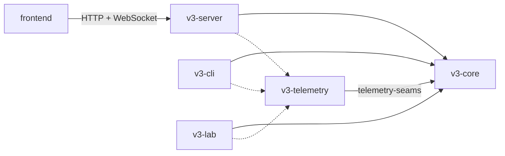
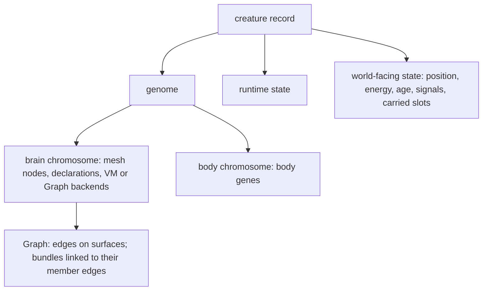

# Petri architecture

**State**: desired. This file describes where the system is going, not what
the code does today. [Known debts](#5-known-debts) lists where the code
differs and the row that pays each debt.
**Last updated**: 2026-10-22

## Use this file

1. **Plan**: read it; a spec names the owners it touches and any boundary it
   changes. Work that changes the desired architecture edits this file in
   the same change.
2. **Implement** toward it, never toward a shape listed as a debt.
3. **Review**: a diff that introduces or widens coupling this file forbids
   is a finding; unchanged existing debt is not.
4. **Close**: delete the debts the feature paid.

The workflow says how ([Plan, Review, Close](workflow.md)). Design detail
belongs in the rows and specs that implement it; this file links to them.

## 1 Rules

1. **One owner per concept.** One module builds, validates and edits a
   concept; every route to it calls that owner.
2. **Dependencies point down, with no cycles** (section 3's order and
   prohibitions).
3. **Composition over inheritance.** Aggregates are composed of parts; a
   variation is a closed enum whose behavior lives in one module, or one
   value type reused in several slots; no trait hierarchies for domain
   objects.
4. **Sampling apart from application.** Mutation samples; the owning domain
   validates and applies deterministically.
5. **Genes, inherited payload and runtime state stay apart.** Derived data is
   computed from the genome once per birth and never stored in the genome
   type.
6. **Observations derive from applied behavior**, and outer crates own
   transport and export.

The design principles behind them (fewest assumptions and most
evolvability inside clean layers, a natural analog for every mechanism, no
backward compatibility) are the [master roadmap's standing rules](roadmap.md).

## 2 System

| Part | Owns | Never |
| --- | --- | --- |
| `v3-core` | the simulation library | I/O, transport, telemetry export, a dependency on another workspace crate |
| `v3-telemetry` | run identity and OTLP export, read through `telemetry-seams` | changing a run or drawing a simulation RNG |
| `v3-cli` | commands, benchmarks, measurements | simulation rules |
| `v3-server` | transport, sessions, query projections (the inspector's brain view among them) and its own wire types | simulation rules; core structs on the wire other than `Direction`, `Position`, the id types and the config schema |
| `v3-lab` | capability assays ([lab contract](lab.md)) | being depended on; anything reaching production |
| `frontend` | rendering and controls over the server API ([frontend rules](../frontend/AGENTS.md)) | copying a core type by hand or recomputing a simulation rule |

The genome and runtime resolve what the inspector shows through their own
read APIs; the server only selects, structures and serializes it, and the
frontend's types are generated from or tested against the server's.

## 3 Core domains

From the bottom up; a domain imports only domains below it, and never one
on its own row:

1. `contracts`
2. `config`, energy ledger
3. world (`kernel`)
4. `patterns`
5. genome (`creature/genome/`)
6. `sensors`
7. `mutation`, `runtime`
8. `creature`
9. `simulation`
10. readers

Named prohibitions, which the order alone does not say:

- The genome imports nothing but `contracts`.
- `mutation` and `runtime` never import each other.
- Sensors never read the genome or a whole creature; they get explicit views
  and a perception-requirements value.
- `runtime` never imports `simulation` or the creature record.
- Simulation behavior never depends on readers.

| Concept | Owner |
| --- | --- |
| shared vocabulary: ids, directions, actions, sensor descriptors (fields, field sets, geometry), the brain I/O catalog (action kinds, vote sinks, parameters, widths derived from it) | `contracts` |
| configuration schema, pattern parameters included | `config` |
| energy-accounting primitives (death cause, debits, cognition energy) | energy ledger |
| world state and world-edit primitives | world (`kernel`) |
| genome structure: chromosomes, nodes, declarations, edges, bundles and wiring; edits that validate and return their effects on inherited values; deterministic analysis, the learning layout among it | genome (the Graph is the aggregate root of edges and bundles) |
| mutation supply, dispatch and every birth draw | `mutation` (samples; owners apply) |
| perception | `sensors` |
| brain execution, its state, learned values and the learning update law | `runtime` |
| the creature record, body rules, and one birth constructor for founders and children (finalization, inherited payload, per-life initialization, energy provisioning) | `creature` |
| tick order; action resolution, each action one transaction with one applied result; removal settled through one path; records derived from applied results | `simulation` (a scheduler and mechanics) |
| censuses and indicators | readers |
| transport, the inspector view, telemetry export | outer crates (section 2) |

## 4 Composition and flow

- **Tick**: `food_growth` → `world_update` → `sensor_assembly` → `cognition`
  (parallel, world frozen) → `actions` → `reward_learning`. The scheduler
  owns the order; mechanics commits actions; runtime updates learning.
  Feature timing contracts (signal visibility, delivery) live in their rows.
- **Birth**: the birth constructor drafts the child (genome, mutation,
  inherited payload, provenance) and finalizes it; the simulation supplies
  world context. Design: [T29](roadmaps/t29-heredity.md).
- **Mutation**: the engine dispatches each event to an operator, which
  samples one edit; the genome validates and applies it. Sensor wiring:
  [T25.F11](roadmaps/t25-edge-groups-and-learning.md).
- **Learning**: genome learning settings → learning layout (once per birth)
  → runtime values and update law. Design: T25.F12.

## 5 Known debts

Where today's code differs from sections 1–4, with the row that pays it.
Delete a line when the code matches. `scripts/architecture-check.mjs` (in
`make check-docs` and `make check`) fails any `v3-core` import against
section 3 except those `scripts/architecture-debts.txt` lists under a debt
here, and fails a listed import the code no longer needs. Design notes:
[sensor wiring](strategy/group-creation-unification-2026-10-22.md),
[bundle learning](strategy/bundle-learning-ownership-2026-10-22.md),
[heredity](strategy/heredity-architecture-2026-10-22.md).

| Debt | Today | Paid by |
| --- | --- | --- |
| G1 | Three routes wire a sensor with three rule sets (`mutation/input_ref/mod.rs:310`, `mutation/graph/recruitment.rs:125`, `mutation/graph/group.rs:121,159`); fact-only branches in `creature/genome/cgp/container.rs:695,1304`; hosting split across `:1105,1117`; non-world sensor widths in `mutation/compound.rs:21-24` | T25.F11 |
| G2 | Brain I/O vocabulary outside `contracts` (`creature/genome/vote.rs`, outcome channels read by `sensors/static_inputs.rs:4`; `OUTPUT_SLOT_COUNT` in `runtime/types.rs`, imported by `mutation/sampling.rs:7`); route resolution and jump targets imported from runtime (`mutation/topology/routing.rs:12`, `mutation/vm/operators.rs:728`) | vocabulary: T25.F11; routes and jumps: T30.F05 |
| G3 | Learning configured on edges only (`creature/genome/mod.rs:180`), group flags beside it (`cgp/group.rs:122`), `Scope::Group` branches (`runtime/plasticity/learned.rs:166-278`), learners found from plastic edges (`creature/genome/companions.rs:57`) | T25.F12 |
| G4 | No birth constructor: `spawn_child` (`simulation/actions/reproduction.rs:376`) and seeding (`simulation/seeding.rs:95`) build creatures separately; learned seeds ride in the genome (`cgp/container.rs:245-246`); `cap_energy` runs after construction (`reproduction.rs:568`); traits draw their own RNG (`creature/identity.rs:43`, `creature/body.rs:80`) | T29.F01 |
| G5 | Body outside the genome (`creature/body.rs:26`), per-birth trait chances (`body.rs:127`), colour and kin tag gated on brain mutation (`reproduction.rs:519`), `lineage_id` in the body (`creature/identity.rs:7`), mutation importing creature's `Phenotype` (`mutation/phenotype.rs:4`) | T29.F02 |
| G6 | Every memory slot passes to the child (`reproduction.rs:386`) | T29.F03 |
| G7 | Energy primitives in `simulation/energy_accounting.rs`, imported by runtime (`runtime/mesh.rs:25`, `runtime/vm.rs:11`, `runtime/cgp/execute.rs:14`, `runtime/types.rs:76`, `runtime/trace/recording.rs:61`) and creature (`creature/state.rs:171,315-317`) | T30.F02 |
| G8 | Runtime state types in the creature record (`creature/state.rs:33,77`), imported by runtime (`runtime/mesh.rs:16`, `runtime/cgp/execute.rs:4`, `runtime/cgp/traced.rs:4`, `runtime/traced_mesh.rs:7`) and mutation (`mutation/reachability.rs:21`) | T30.F02 |
| G9 | Sensors read the whole creature and its colour helper (`sensors/reducers.rs:8-9`, `sensors/static_inputs.rs:3,5`) while the creature record imports `sensors::reads` (`creature/state.rs:19`) | T30.F03 |
| G10 | A config→patterns→kernel cycle (`config/simulation.rs:360-361`, `patterns/mod.rs:18`, `kernel/fertility/mod.rs`) | T30.F04 |
| G11 | The kernel imports a creature hash helper (`kernel/ordinary_food/stream.rs:10`) | T30.F04 |
| G12 | The genome validity gate lives in `creature/parseability.rs`, imported by `mutation/engine/mod.rs:9` | T30.F05 |
| G13 | The InputRef mutations edit declarations and Graph edges by hand (`mutation/input_ref/mod.rs:338,366`) | T25.F11 |
| G14 | Production reads readers: sensor caches computed by a census at construction (`creature/state.rs:16,250`); the inheritance witness reads `creature::drives::PATH_WEIGHT_FLOOR` (`simulation/actions/reproduction.rs:128`) | caches: T30.F03; witness: T25.F11 |
| G15 | Genome analysis draws randomness (`creature/genome/analysis.rs:180,229`, called by `mutation/vm/operators.rs:879,898`) | T30.F05 |
| G16 | A runtime trace carries simulation and creature records (`runtime/trace/domain.rs:63,107`) | T30.F02 |
| G17 | The genome's internal layout is the frontend's API (`v3-server/src/http/creature.rs:67,505`, `transport/sample_assembler.rs:162`); `frontend/src/types/genome.ts` copies genome types by hand and five inspector files recompute genome rules | T30.F01 |
| G18 | Two result vocabularies: `ActionResult` (`creature/action_log.rs:15`) and a success boolean for rewards (`simulation/outcomes.rs:53`) | T30.F06 |
| G19 | Action resolution mixed with scheduling: executors in `simulation/tick.rs:940-1184` beside `run_tick` (`:1385`), action flooring and removal in the scheduler (`:1303-1320`), mechanics taking the whole `Simulation` (`simulation/actions/giving.rs:7`, `predation.rs:4`), move effort composed on the creature record (`creature/state.rs:302`) | T30.F06 |
| G20 | Sensors read the genome to decide what to assemble (`sensors/perception.rs:182`, `sensors/typed_food.rs:72`) | T30.F03 |
